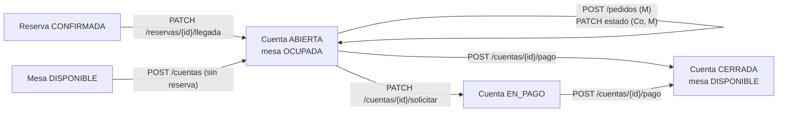
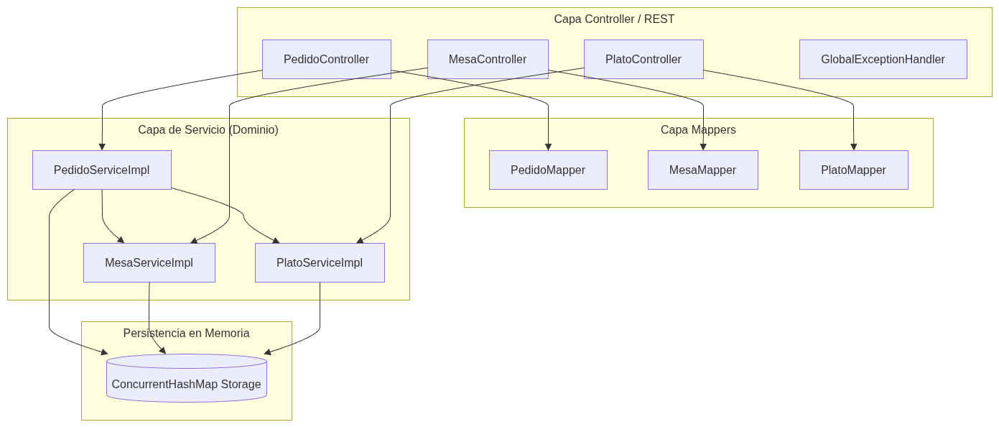
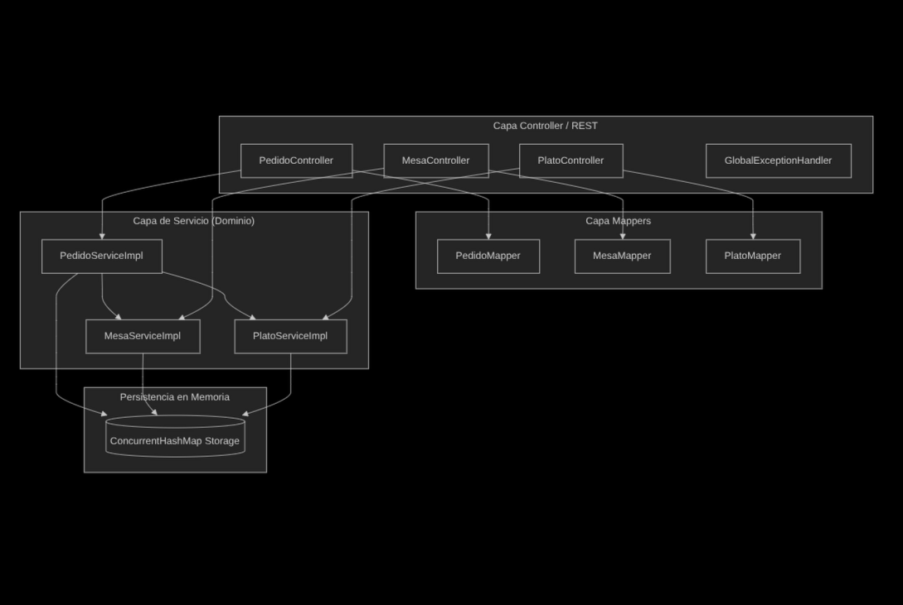
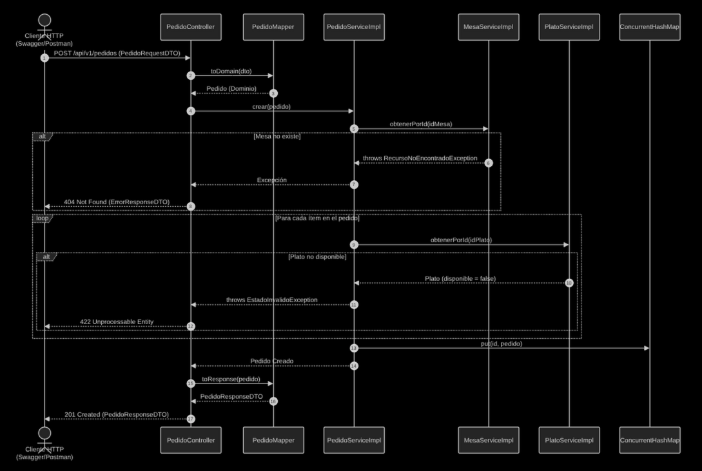
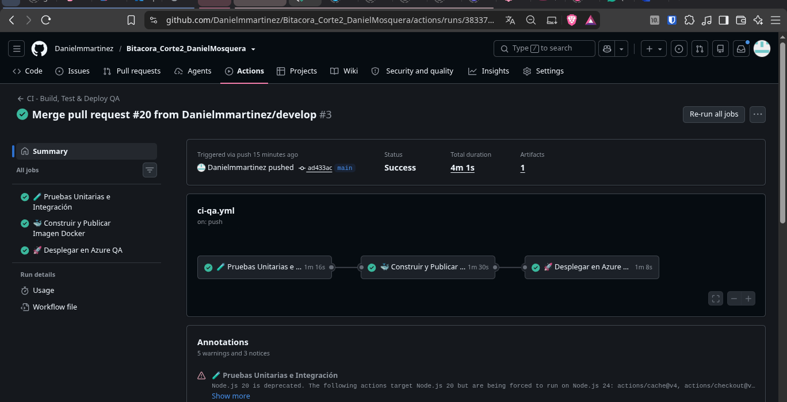
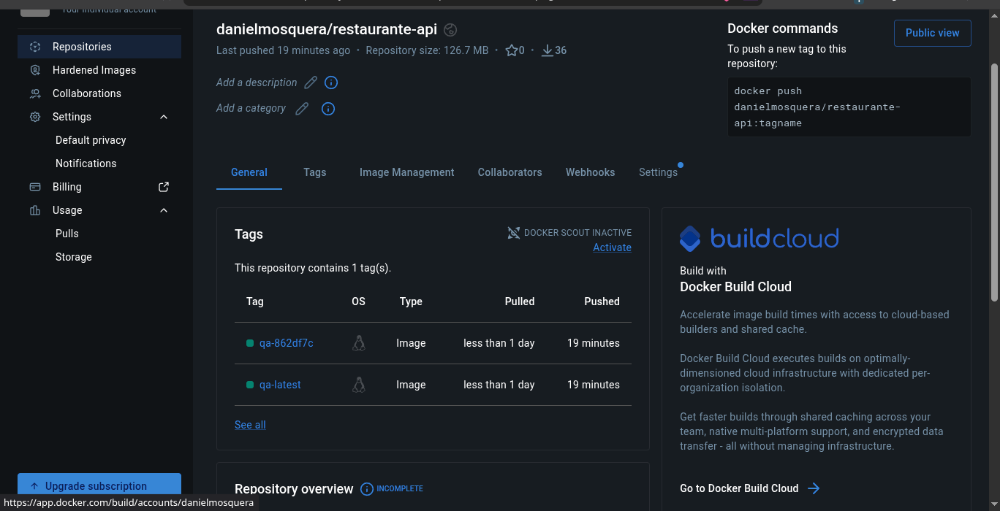
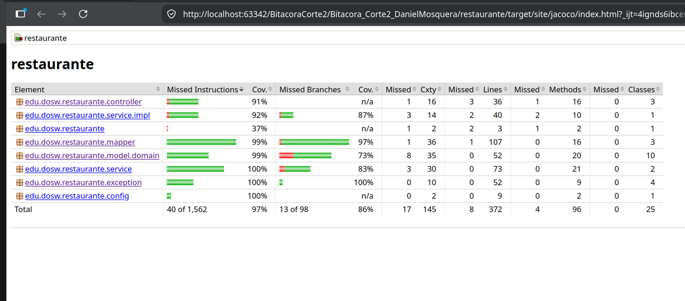
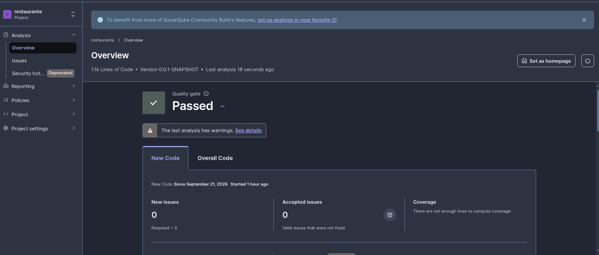
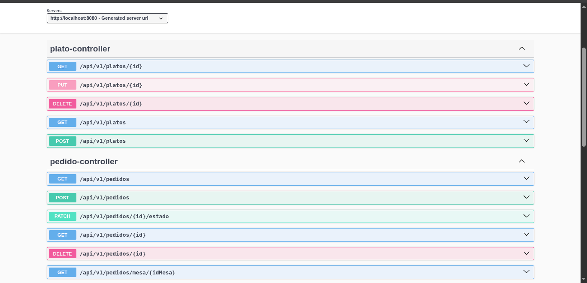
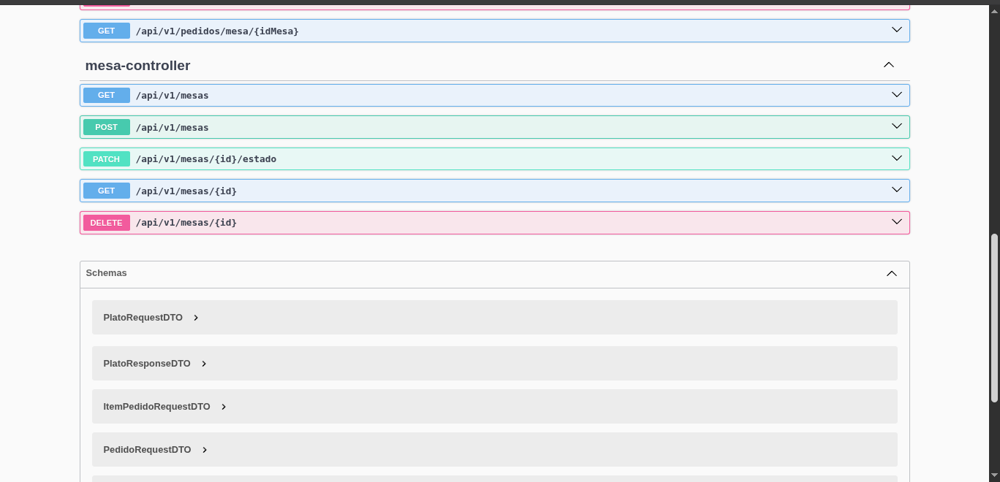

# Sakura Sushi — API REST

* **Autor:** Daniel Mosquera
* **Materia:** DOSW — Bitácora Corte 2 & Semana 10
* **Concepto:** Restaurante Japonés

---

## Tecnologías y Herramientas

* **Lenguaje & Framework:** Java 21, Spring Boot 3.3.x
* **Arquitectura & Diseño:** Arquitectura en Capas, Modelo de Dominio
* **Herramientas de Construcción:** Apache Maven
* **Mapeo y Boilerplate:** Lombok, MapStruct 
* **Documentación Interactiva:** Springdoc OpenAPI / Swagger UI
* **Seguridad:** Spring Security + **JWT** (jjwt), Roles granulares con `@PreAuthorize`, Contraseñas con BCrypt, CORS estricto
* **Persistencia Relacional:** PostgreSQL (producción / Docker) y H2 (pruebas locales en memoria) con **Spring Data JPA / Hibernate**
* **Persistencia No Relacional:** **MongoDB** para auditoría e historial de eventos de pedidos (`@Async`)
* **Contenedores:** Dockerfile multi-etapa, Docker Compose (API + PostgreSQL + MongoDB)
* **CI/CD:** GitHub Actions con despliegue automático en Azure App Service
* **Pruebas:** JUnit 5, Mockito, `@WebMvcTest`, `@DataJpaTest`, `@DataMongoTest`, Testcontainers (MongoDB real en Docker), Spring Security Test
* **Calidad y Cobertura:** JaCoCo, SonarQube / SonarLint

---

## Cómo Empezar (Ejecución Local)

### Opción A: Con Docker Compose (Recomendado — Todo el stack)
```bash
# Construir imágenes y encender API + PostgreSQL + MongoDB
docker compose up --build -d

# Ver estado de los contenedores
docker compose ps

# Ver logs de la aplicación
docker compose logs -f api

# Apagar el entorno
docker compose down
```

### Opción B: Ejecución nativa con Maven (H2 local)
```bash
mvn spring-boot:run
```
* **Swagger UI Local:** [http://localhost:8080/swagger-ui/index.html](http://localhost:8080/swagger-ui/index.html)
* **Consola H2:** [http://localhost:8080/h2-console](http://localhost:8080/h2-console) (JDBC URL: `jdbc:h2:file:./data/restaurante`, usuario: `sa`, sin contraseña).

---

## Credenciales de Prueba (Demo)

Para probar la seguridad en Swagger UI, haz `POST /api/v1/auth/login` con alguno de los siguientes usuarios demo (`restaurante.seguridad.usuarios-demo=true`), copia el `token` de la respuesta y pégalo en el botón superior **Authorize** (`Bearer <token>`):

| Rol | Email | Contraseña | Permisos principales |
| :--- | :--- | :--- | :--- |
| **Gerente** | `gerente@sakura.com` | `Gerente123!` | Administración total: CRUD de platos, mesas, reportes e historial |
| **Mesero** | `mesero@sakura.com` | `Mesero123!` | Toma de pedidos, apertura de cuentas, parqueadero y mesas |
| **Cocinero** | `cocinero@sakura.com` | `Cocinero123!` | Visualización de pedidos, avance de estados en cocina y platos |
| **Cliente** | `cliente@sakura.com` | `Cliente123!` | Reservas propias y consulta de carta en `/menu` |

---

## Funcionalidades y Tabla de Endpoints

**Roles:** **G** = Gerente · **M** = Mesero · **Co** = Cocinero · **Cl** = Cliente · **Público** = sin token.  
Todas las rutas protegidas responden `401 Unauthorized` si no hay token válido y `403 Forbidden` si el rol no tiene permisos.

| Módulo | Método | Endpoint | Descripción | Roles | Éxito | Errores |
| :--- | :--- | :--- | :--- | :--- | :--- | :--- |
| **Auth** | `POST` | `/api/v1/auth/login` | Iniciar sesión y obtener JWT | Público | `200` | `400`, `401` |
| **Auth** | `POST` | `/api/v1/auth/registro` | Registro público de clientes | Público | `201` | `400`, `409` |
| **Auth** | `GET` | `/api/v1/auth/yo` | Información del usuario en sesión | Todos | `200` | `401` |
| **Menú** | `GET` | `/api/v1/menu` | Carta para clientes (solo disponibles) | Público | `200` | — |
| **Menú** | `GET` | `/api/v1/menu/{id}` | Detalle de un plato disponible | Público | `200` | `404` |
| **Menú** | `GET` | `/api/v1/menu/categoria/{categoria}` | Filtrar carta por categoría | Público | `200` | — |
| **Platos** | `GET` | `/api/v1/platos` | Catálogo completo de platos | G, M, Co | `200` | — |
| **Platos** | `GET` | `/api/v1/platos/{id}` | Obtener plato por ID | G, M, Co | `200` | `404` |
| **Platos** | `POST` | `/api/v1/platos` | Crear nuevo plato | G | `201` | `400`, `409` |
| **Platos** | `PUT` | `/api/v1/platos/{id}` | Actualizar plato existente | G | `200` | `400`, `404`, `409` |
| **Platos** | `PATCH` | `/api/v1/platos/{id}/disponible?disponible=` | Cambiar disponibilidad | G, M, Co | `200` | `400`, `404` |
| **Platos** | `DELETE` | `/api/v1/platos/{id}` | Eliminar un plato | G | `204` | `404` |
| **Mesas** | `GET` | `/api/v1/mesas?estado=` | Listar mesas (filtro opcional) | G, M | `200` | `400` |
| **Mesas** | `GET` | `/api/v1/mesas/{id}` | Obtener mesa por ID | G, M | `200` | `404` |
| **Mesas** | `POST` | `/api/v1/mesas` | Registrar una mesa | G | `201` | `400`, `409` |
| **Mesas** | `PUT` | `/api/v1/mesas/{id}` | Modificar número y capacidad | G | `200` | `400`, `404`, `409` |
| **Mesas** | `PATCH` | `/api/v1/mesas/{id}/estado?estado=` | `DISPONIBLE` ↔ `RESERVADA` | G, M | `200` | `400`, `404`, `422` |
| **Mesas** | `DELETE` | `/api/v1/mesas/{id}` | Eliminar mesa sin cuenta abierta | G | `204` | `404`, `409` |
| **Cuentas** | `GET` | `/api/v1/cuentas?estado=` | Listar cuentas con total | G, M | `200` | `400` |
| **Cuentas** | `GET` | `/api/v1/cuentas/{id}` | Obtener cuenta por ID | G, M | `200` | `404` |
| **Cuentas** | `GET` | `/api/v1/cuentas/mesa/{idMesa}` | Cuenta activa de una mesa | G, M | `200` | `404` |
| **Cuentas** | `POST` | `/api/v1/cuentas` | Abrir cuenta (ocupa la mesa) | G, M | `201` | `400`, `404`, `409` |
| **Cuentas** | `PATCH` | `/api/v1/cuentas/{id}/solicitar` | Pasar cuenta a `EN_PAGO` | G, M | `200` | `404`, `422` |
| **Cuentas** | `POST` | `/api/v1/cuentas/{id}/pago` | Pagar: congela total, cierra y libera mesa | G, M | `200` | `400`, `404`, `422` |
| **Pedidos** | `GET` | `/api/v1/pedidos?estado=` | Listar pedidos (filtro por estado) | G, M, Co | `200` | `400` |
| **Pedidos** | `GET` | `/api/v1/pedidos/{id}` | Obtener pedido por ID | G, M, Co | `200` | `404` |
| **Pedidos** | `GET` | `/api/v1/pedidos/mesa/{idMesa}` | Pedidos de una mesa | G, M, Co | `200` | `404` |
| **Pedidos** | `GET` | `/api/v1/pedidos/{id}/historial` | Historial no relacional en MongoDB | G | `200` | `503` |
| **Pedidos** | `POST` | `/api/v1/pedidos` | Crear pedido en cuenta abierta | G, M | `201` | `400`, `404`, `422` |
| **Pedidos** | `PUT` | `/api/v1/pedidos/{id}` | Modificar pedido en `RECIBIDO` | G, M | `200` | `400`, `404`, `422` |
| **Pedidos** | `PATCH` | `/api/v1/pedidos/{id}/estado?estado=` | Transicionar estado de pedido | G, M, Co | `200` | `400`, `404`, `422` |
| **Pedidos** | `DELETE` | `/api/v1/pedidos/{id}` | Eliminar pedido en `RECIBIDO` | G, M | `204` | `404`, `422` |
| **Reservas** | `GET` | `/api/v1/reservas?fecha=` | Listar reservas (clientes: solo las suyas) | G, M, Cl | `200` | `400` |
| **Reservas** | `GET` | `/api/v1/reservas/{id}` | Obtener reserva por ID | G, M, Cl | `200` | `404` |
| **Reservas** | `GET` | `/api/v1/reservas/disponibilidad` | Mesas libres por fecha y capacidad | G, M, Cl | `200` | `400`, `422` |
| **Reservas** | `POST` | `/api/v1/reservas` | Crear reserva | G, M, Cl | `201` | `400`, `404`, `409`, `422` |
| **Reservas** | `PUT` | `/api/v1/reservas/{id}` | Reprogramar reserva | G, M, Cl | `200` | `400`, `404`, `409`, `422` |
| **Reservas** | `PATCH` | `/api/v1/reservas/{id}/cancelar` | Cancelar reserva | G, M, Cl | `200` | `404`, `422` |
| **Reservas** | `PATCH` | `/api/v1/reservas/{id}/llegada` | Registro de llegada y apertura de cuenta | G, M | `200` | `404`, `409`, `422` |
| **Parqueadero** | `POST` | `/api/v1/parqueadero/entrada` | Entrada de vehículo (auto o moto) | G, M | `201` | `400`, `409`, `422` |
| **Parqueadero** | `POST` | `/api/v1/parqueadero/salida/{placa}` | Salida y liquidación por hora o fracción | G, M | `200` | `404` |
| **Parqueadero** | `GET` | `/api/v1/parqueadero/estado` | Cupos disponibles y vehículos dentro | G, M | `200` | — |
| **Parqueadero** | `GET` | `/api/v1/parqueadero/registros?fecha=` | Entradas del día | G, M | `200` | `400` |
| **Parqueadero** | `GET` | `/api/v1/parqueadero/registros/{id}` | Detalle de registro de parqueadero | G, M | `200` | `404` |
| **Reportes** | `GET` | `/api/v1/reportes/resumen?fecha=` | Resumen operativo del día | G | `200` | `400` |
| **Reportes** | `GET` | `/api/v1/reportes/platos-mas-vendidos` | Ranking de platos vendidos | G | `200` | `400` |
| **Reportes** | `GET` | `/api/v1/reportes/ingresos` | Ingresos por día, método y categoría | G | `200` | `400` |

### Flujo Operativo de una Mesa


---

## Docker y Contenedores

La API se distribuye mediante un `Dockerfile` multietapa optimizado:
1. **Builder:** Compilación con `maven:3.9-eclipse-temurin-21`.
2. **Runner:** Imagen ligera `eclipse-temurin:21-jre-alpine` con perfil `docker`.

### Repositorio en Docker Hub
* **Imagen pública:** `docker pull danielmosquera/restaurante-api:qa-latest`
* **Enlace Docker Hub:** [https://hub.docker.com/r/danielmosquera/restaurante-api](https://hub.docker.com/r/[TU_USUARIO_DOCKERHUB]/restaurante-api)

### Variables de entorno (`application-docker.yml` / `.env`)
* `DB_HOST`, `DB_PORT`, `DB_NAME`, `DB_USER`, `DB_PASSWORD`: Credenciales de PostgreSQL.
* `MONGO_URI`: Conexión de MongoDB para auditoría.
* `JWT_SECRET`: Clave de firma HMAC-SHA256.
* `CORS_ORIGENES`: Lista blanca de orígenes cliente.

---

## CI/CD y Despliegue en Azure (Semana 10)

El despliegue está 100% automatizado con **GitHub Actions**:

###  URLs Públicas en Azure
* **Ambiente QA:** `https://app-restaurante-qa-daniel.azurewebsites.net/swagger-ui/index.html`
* **Ambiente PROD:** `https://app-restaurante-prod-daniel.azurewebsites.net/swagger-ui/index.html`

### Flujo de Integración y Despliegue Continuo
1. **Pipeline QA (`ci-qa.yml`):**
    * Gatillado con cada `push` o `Pull Request` a `main`.
    * Ejecuta la suite de pruebas unitarias y de integración (`mvn test`).
    * Construye la imagen Docker y la publica en Docker Hub con tags `qa-*` y `qa-latest`.
    * Despliega automáticamente en Azure App Service (QA) e inyecta variables de entorno.
2. **Pipeline PROD (`ci-prod.yml`):**
    * Se activa al etiquetar versiones semánticas (`v*.*.*`).
    * Construye imagen con tags semver y `latest`.
    * Requiere **aprobación manual** de revisores en el entorno `production` de GitHub antes de desplegar en Azure PROD.

### Secretos Gestionados en GitHub Actions
* `DOCKERHUB_USERNAME` / `DOCKERHUB_TOKEN`: Autenticación para Docker Hub.
* `AZURE_CREDENTIALS`: Service Principal de Azure en formato JSON.
* `AZURE_WEBAPP_NAME_QA` / `AZURE_WEBAPP_NAME_PROD`: Nombres de las Web Apps en Azure.
* `DB_PASSWORD_QA` / `DB_PASSWORD_PROD`: Contraseñas de bases de datos por entorno.
* `JWT_SECRET_QA` / `JWT_SECRET_PROD`: Claves secretas de JWT segregadas.

---

## Seguridad y Mitigación OWASP Top 10

La API protege la integridad de los datos aplicando estándares de la industria:
* **Autenticación sin estado:** JWT con expiración estricta y firma HMAC-SHA256.
* **Control de Acceso Basado en Roles (RBAC):** Uso de `@PreAuthorize` en controladores.
* **Protección de Contraseñas:** Hash con `BCryptPasswordEncoder` (con salt dinámico).
* **CORS Seguro:** Configurado explícitamente en `CorsConfig` evitando comodines `*` combinados con credenciales.

### Checklist OWASP Top 10
| Vulnerabilidad OWASP | Estado | Mitigación Implementada |
| :--- | :---: | :--- |
| **A01: Broken Access Control** | ✅ Mitigado | `@PreAuthorize` por rol (`GERENTE`, `MESERO`, `COCINERO`, `CLIENTE`). Validación de propiedad en reservas para clientes. |
| **A02: Cryptographic Failures** | ✅ Mitigado | Contraseñas protegidas con BCrypt. Token firmado con clave de 256 bits en Base64. Variables sensibles fuera del código fuente. |
| **A03: Injection (SQL / NoSQL)** | ✅ Mitigado | Consultas parametrizadas y tipadas con Spring Data JPA y MongoDB. Cero concatenación directa de SQL/HQL. |
| **A04: Insecure Design** | ✅ Mitigado | Arquitectura en 3 capas. Modelo de Dominio Puro aislado de entidades y DTOs de exposición. |
| **A05: Security Misconfiguration** | ✅ Mitigado | `GlobalExceptionHandler` intercepta fallos y oculta trazas de error internas devolviendo `500 Internal Server Error` genérico. |
| **A07: Identification & Auth Failures** | ✅ Mitigado | Tokens JWT con expiración. Mensaje genérico de credenciales inválidas para evitar enumeración de cuentas. |
| **A08: Software & Data Integrity** | ✅ Mitigado | Verificación de firma criptográfica en cada petición HTTP por medio de `JwtAuthFilter`. |
| **A09: Security Logging & Monitoring** | ✅ Mitigado | Trazabilidad con `@Slf4j` en eventos críticos y persistencia no relacional en MongoDB tolerante a fallos (`@Async`). |

---

## Diagramas y Evidencias

### Diagrama de Clases


### Diagrama de Componentes


### Diagrama de Secuencia


### Diagrama de Despliegue (draw.io)


### Pipeline GitHub Actions (100% Verde)


### Docker Hub y Contenedores
* **Docker Hub con Tags Generados:**  
  


### Cobertura JaCoCo & SonarQube
* **JaCoCo:**  
  
* **SonarQube:**  
  

### Swagger UI

